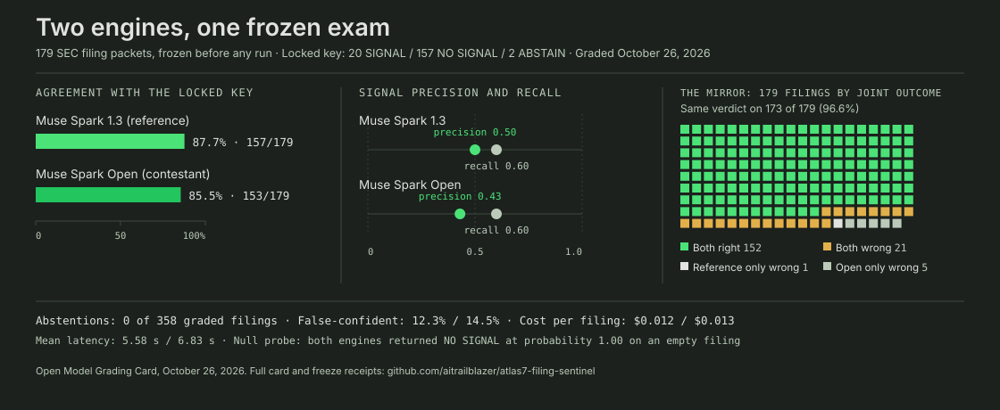

# ATLAS-7 Filing Sentinel

**Meta Global AI Developer Hackathon, Startup track.**

**One-liner:** ATLAS-7 Filing Sentinel is an evaluation system for SEC filings: it evaluates filings for material signal, and it evaluates the AI models that read them, both against a locked answer key.

## Contents

- [Why we entered](#why-we-entered)
- [The problem and the workflow](#the-problem-and-the-workflow)
- [The proof: we graded the engines](#the-proof-we-graded-the-engines)
- [The demo film](#the-demo-film)
- [Repository layout](#repository-layout): the [grading harness](harness/), the [demo grading prompt](DEMO-GRADING-PROMPT.md), the [Open Model Grading Card](GRADING-CARD.md), the [freeze receipts](freeze/), and the [sealed demo set](demo-set/)
- [Links and receipts](#links-and-receipts)
- [Links](#links)

## Why we entered

We entered for the jury and the deadline, in that order. The jury: this product runs on Meta's models, and its daily work is evaluating them, every graded filing a small judgment on whether the engine read the document the way the desk reads it. Meta's AI leadership has said in public that crafting evals from real product work is where the field's most important problems now sit. An entrant whose core discipline is evaluation belongs in front of that jury, and its verdict, favorable or not, is information we cannot generate for ourselves. The deadline: the frozen exam at the center of this submission exists because this event does. On our own calendar we would have graded the engines eventually and informally; the competition forced the freeze, the locked key, the sealed demo set, and the public card, inside one month and to a standard we intend to keep. The prize would be welcome and is budgeted nowhere in our plans. What we came for is already in this document: a dated, external, checkable measurement of the work, taken by the ecosystem the work is built on.

## The problem and the workflow

The SEC receives a flood of filings every day. Most of it is routine paper: administrative notices, boilerplate, restatements of what is already public. A small share carries real information, a concrete event or change that a reasonable investor would treat as new. The material filings hide inside the routine ones, and a full filing package takes a human the better part of an hour to read properly. The independent investor, the small desk, and the solo analyst cannot read everything, so they read what is loudest, which is not the same as what matters.

The Filing Sentinel grades every filing the same way. For each one it returns a verdict, SIGNAL or NO SIGNAL, a probability for each class, and one sentence naming the specific filing content the verdict rests on. A verdict issues only when the engine's top-class probability reaches 0.85. Below that band the engine must abstain, so thin evidence produces no grade instead of a confident guess. The desk then reads only what the sentinel graded as signal, plus whatever it refused to grade, and every verdict carries its basis sentence and its probability, so a human can check the reasoning before acting on it.

This is a port of a running production system, not a prototype built for the event. The desk's graded filing record is public and dated, its misses printed at the same size as its wins, and the grading corpus behind it is locked and hash-verified. Filings are also read as steps in sequences, not as isolated documents: a fourth insider sale in four months is a pattern advancing, and the sentinel's scaffolding holds that sequence state, because a raw model reading one document alone cannot.

## Built during the hackathon

This entry builds on ATLAS-7, a running production system: the filing-grading engine, the grading corpus, and the desk's public dated record all pre-date the event and are not claimed as hackathon work. What was created inside the event window:

- The frozen 179-filing grading exam and its lock (October 26): the sample, the demo grading prompt, and the abstain band frozen in one commit (834454df in aitrailblazer/coordination), the answer key pinned by hash before any engine ran.
- Both grading runs (October 26): Muse Spark 1.3 as the reference arm on the Meta Model API and Muse Spark Open as the contestant arm on Baseten, scored in the Open Model Grading Card in this repository.
- This public repository and the grading card.
- The sealed ten-filing demo set, the three demo configurations, and the three-minute demo film; the configurations were re-run on the hackathon build (muse-spark-open-1026) on October 27.
- The measurement program running this week: a pre-registered abstention measurement on about 2,000 fresh filings and a matched validation of the product's grading method on a newly locked answer key, both designs written and dated before any run, with results published in this repository on October 30.

## The proof: we graded the engines

Because the product stands on a general engine, we measured the engine, under conditions a skeptic can re-run. Every engine reads the same 179 filing packets, under the same demo grading prompt, with the same abstain band. Nothing was tuned after the freeze. The sample, the prompt, the band rule, and a per-packet hash manifest were frozen in one commit before any engine saw a packet: commit 834454df in aitrailblazer/coordination, path hackathon/open-model-grading/.

The answer key was pinned by hash before the first engine call: Decider corpus v4 finals (20 SIGNAL / 157 NO SIGNAL / 2 ABSTAIN over 179 filings), file sha256 8126b36c40f13bde4ee7e959f292c3b4725ba94deffb5d397281d48359f1bf96. The key was built by two independent Muse grading desks working blind, their disagreements ruled on by a fresh judge blind to label origin, and the result locked by a human. The key stays home and never ships; only the demo grading prompt goes to any external route.

The result is published as the Open Model Grading Card, a grading card for the engines, not for the filings. Each engine's verdicts are scored against the locked key, and its agreement is published as the engine's score, next to its misses. Agreement is a score for the engine. It is never validation of the record the key comes from: the key is the ruler, and a ruler is not validated by the things measured with it.

![Open Model Grading, both arms: Muse Spark 1.3 agreement 87.7% (157 of 179 packets, scope 38 complete submissions and 141 primary-plus-EX-99), SIGNAL precision 0.50, recall 0.60; Muse Spark Open agreement 85.5% (153 of 179), SIGNAL precision 0.43, recall 0.60; the two models gave the same verdict on 173 of 179 filings (96.6%); abstentions 0 on both runs with lowest verdict probability 0.88; null probe NO SIGNAL at 1.00 on both runs with nothing invented; cost about $0.012 and $0.013 per graded filing at list prices; zero failed calls](assets/grading-infographic.svg)

**The reference arm, Muse Spark 1.3.** On the Meta Model API, Muse Spark 1.3 graded all 179 packets plus one empty, filing-shaped null document, 180 calls at temperature 0, on October 26, 2026. It agreed with the key on 157 of 179 filings, 87.7% (corpus scope: 38 complete submissions, 141 at primary-plus-EX-99 scope). Its SIGNAL precision was 0.50. Its SIGNAL recall was 0.60. It abstained zero times, and the lowest probability on any of its verdicts was 0.88, above the 0.85 band edge, so all 22 of its disagreements with the key were confident disagreements, a false-confident rate of 12.3%, including both gold ABSTAIN filings, which it called NO SIGNAL at 0.92 and 0.95. The null probe passed: given the empty document, it returned NO SIGNAL at probability 1.00 with the basis "empty packet", inventing nothing. The run took 16 minutes 53 seconds with zero failed calls, consumed 1,171,914 tokens, and prices at list rates to $2.16, about $0.012 per graded filing, at a mean latency of 5.58 seconds. The largest packet, at 183,823 prompt tokens, was accepted and graded in a single pass.

**The contestant arm, Muse Spark Open.** On Baseten, the open-weights Muse Spark Open graded the same 179 packets plus the null document under the same frozen prompt and the same band, on October 26, 2026, charged against the workspace's $5.00 of free Model API credits, with no payment method on file. Muse Spark Open agreed with the key on 153 of 179 filings, 85.5%. Muse Spark Open's SIGNAL precision was 0.43. Muse Spark Open's SIGNAL recall was 0.60, the same 12 gold SIGNAL filings found and the same 8 missed as the reference arm. Muse Spark Open abstained zero times. The lowest probability on any Muse Spark Open verdict was 0.88. All 26 of Muse Spark Open's disagreements with the key were confident, a false-confident rate of 14.5%, including both gold ABSTAIN filings, which it called NO SIGNAL at 0.90 and 0.92. The null probe passed on this route too, NO SIGNAL at probability 1.00, basis "empty packet". The run consumed 1,231,707 tokens and prices at list rates to $2.34, about $0.013 per graded filing, at a mean latency of 6.83 seconds, with zero failed calls.

**The mirror.** The two arms gave the same verdict on 173 of 179 filings, 96.6%. They were both wrong on the same 21 filings. The reference arm was wrong alone on 1 filing. The open model was wrong alone on 5 filings. All six differences are gold NO SIGNAL filings where one arm raised a false alarm and the other did not, which is what moves precision from 0.50 to 0.43. Whatever drives the 21 shared disagreements, including the same confident miss on the same Form 144 read by both engines as one routine proposed sale, is common to both routes. It is not a hosting difference, and it is not fixed by choosing the served model over the open one. It is the layer the product exists to supply: sequence knowledge, and an abstention discipline the raw models do not supply on their own. That layer is DeltaSignal's scaffolding, built from the start around the knowledge that a raw model will grade anything put in front of it, confidently, on thin evidence included. It cannot be reconstructed from this submission or from the public card: what we publish is results and receipts, never the corpus, the labels, or the method the scaffolding runs on.

**A sealed demo set.** Ten filings taken from the live EDGAR feed on October 26, 2026, outside the frozen 179, assembled into packets and labeled in-house before any engine saw them. The labels file is sealed by hash (sha256 30d73538229406da1adb51e1c3510a5df6aa78fb8d77a168fdc488ff313b883b) and never ships. The demo film grades these filings live and reveals the sealed labels after.

## The demo film

Three minutes, two falsifiable moments. First, the product grades a sealed demo filing live on Muse Spark Open, the sequence panel showing why the document alone misleads, and the sealed label is revealed after the verdict. Second, the product sits out a thin-evidence filing, no grade issued, against the exam's aggregate finding that neither flagship model abstained once in 358 graded filings. The film closes on the Grading Card and the freeze receipts: the record is free, the precision is the product.

## Repository layout

- `harness/run_grading.py` — the grading runner: one frozen prompt, one packet per call, strict JSON verdicts, resume-safe output. It never reads labels.
- `harness/score_run.py` — the scorer: takes a results file and a labels file (supplied by whoever scores; no labels are bundled) and prints the card's metrics.
- `DEMO-GRADING-PROMPT.md` — the only prompt that ships to any external route.
- `GRADING-CARD.md` — the Open Model Grading Card, the submission's exhibit.
- `freeze/` — the freeze receipts: freeze manifest, per-packet hash manifest (`.md` and `.jsonl`), and the null document.
- `demo-set/` — the sealed demo set: 10 packets from the live EDGAR feed of October 26, 2026, plus its manifest. The labels are sealed by hash in the manifest and never ship.

## Links and receipts

- **Freeze of record:** commit 834454df, repository aitrailblazer/coordination, path hackathon/open-model-grading/ (freeze manifest, freeze pack, per-packet hash manifest for all 179 packets and the null document, demo grading prompt).
- **Answer key pin:** final-labels-corpus-179-v4.jsonl, sha256 8126b36c40f13bde4ee7e959f292c3b4725ba94deffb5d397281d48359f1bf96. The key itself stays home and is not linked.
- **The exhibit:** the Open Model Grading Card ([GRADING-CARD.md](GRADING-CARD.md)).
- **Demo set seal:** labels sha256 30d73538229406da1adb51e1c3510a5df6aa78fb8d77a168fdc488ff313b883b (labels sealed October 26, 2026, before any engine run; the labels file never ships).

## Links

- AITrailblazer: https://aitrailblazer.com
- Evaluation engagements: https://aitrailblazer.com/evaluation-services
- The public filings record: https://atlas7.app
- X: https://x.com/AITrailblazerQ
- DeltaSignal on Substack: https://deltasignal.substack.com

---

© 2026 AITrailblazer. The ATLAS-7 Filing Sentinel and the Open Model Grading Card are publications of DeltaSignal.

Judge the record, not the story: every figure in this repository traces to a frozen receipt listed under freeze/.
